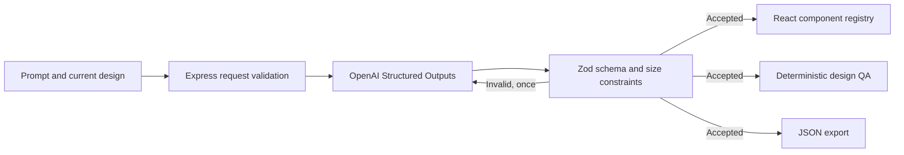

# DesignForge AI

DesignForge converts dashboard briefs into editable single-screen prototypes. Designers can refine a screen through follow-up prompts, preview its responsive layout and UI states, run deterministic checks, and export versioned JSON for handoff.

## Run locally

Use Node 22 LTS or newer.

```sh
npm ci
npm run dev
```

Open the local URL printed by Vite. The starter merchant dashboard works in demo mode. Select an example to generate a preset, choose **Mobile** and **State** to inspect it, then select **Fix issues** to add missing states. **Export JSON** downloads the updated design. The last screen is kept in the current browser.

For custom dashboard prompts, set `GROQ_API_KEY` or `OPENAI_API_KEY` in `.env` and restart development. When both keys are set, Groq is used. The default Groq model is GPT-OSS 20B. Keep the key in a server environment variable, with no `VITE_` prefix. For a fresh design, select **New dashboard** and describe a dashboard with metrics, records, or activity. For a follow-up, enter a request while a design is open.

## Architecture



- React, TypeScript, Vite, Tailwind and a local shadcn/ui-style button primitive power the three-panel workspace. A closed registry renders heading, paragraph, card, stat, button, input, table, badge, divider, and container nodes.
- Express sends a strict JSON Schema derived from Zod to [Groq Chat Completions](https://console.groq.com/docs/structured-outputs) or the [OpenAI Responses API](https://developers.openai.com/api/docs/guides/structured-outputs). The model receives the current design for edits and returns a full updated screen. Repair runs once for malformed, incomplete, or invalid output.
- Zod rejects unknown components, properties, token variants, duplicate IDs, and malformed tables. QA flags missing loading, empty, and error copy, skipped heading levels, unlabeled inputs or buttons, and missing table captions. React renders text through fixed components. Generation never executes model output.
- The API serves the frontend from the same origin in production. Requests have body, rate, time, output, and concurrent generation limits. Provider responses and request bodies are excluded from application logs. Prompts and current screen JSON are sent to the configured model provider when live generation is enabled.

## Verify

```sh
npm test
npm run build
npm run eval
```

The tests cover all demo presets, edits, deterministic QA, schema rejection, repair, provider refusals, API validation and throttling. GitHub Actions runs the tests and production build. The default eval runs eight offline cases without an API key and checks preset quality, edit behavior, and demo rejections. Run `npm run eval -- --live` for ten live cases that check generation, edit preservation, QA, and scope rejection. The live run requires a server-side key and counts against that provider’s quota. The Groq eval honors short rate-limit waits and reports them separately from generation latency.

On November 16, 2026, GPT-OSS 20B on Groq passed 10/10 live cases. Five new dashboards passed QA, the metric rename preserved every other field, and all four out-of-scope requests were declined. Across the six accepted outputs, p50 was 1.18 s and p95 was 2.98 s, excluding about 209 s of rate-limit waits across the run. Results are from a single run.

## Deploy

1. Push this directory to a GitHub repository.
2. In Render, create a Blueprint pointing to your repository. The included `render.yaml` builds and serves the Vite frontend and Express API in one web service with `/api/health` as its health check. See the [Render Blueprint reference](https://render.com/docs/blueprint-spec).
3. Open the deployment URL and verify the example, mobile view, QA repair, and JSON download. The service starts in demo mode.
4. To enable live generation on a restricted or private deployment, set `GROQ_API_KEY` or `OPENAI_API_KEY` in the service environment. Use a dedicated API project and monitor usage. The in-memory throttles reset on restart and are not an account-level spending limit.

For a local production preview, run `npm run build` and `npm start`, then open http://127.0.0.1:3001.

## Design decisions and limits

The screen schema prioritizes predictable rendering and handoff. The server requires each generated dashboard to contain a stat or table. The model classifies the requested scope, so semantic rejection is best-effort. The rendering and export boundary is enforced by the component schema. Model edits return a full document, so keeping unaffected content is guided by the prompt. Buttons and inputs are visual prototypes. Loading, empty, and error views preview state copy without a connected data source. The QA rules are a targeted checklist for this registry. They do not certify accessibility.

A 60-second demo can show the merchant example, switch to mobile, inspect the missing empty state, apply **Fix issues**, preview the repaired state, and export the JSON.
